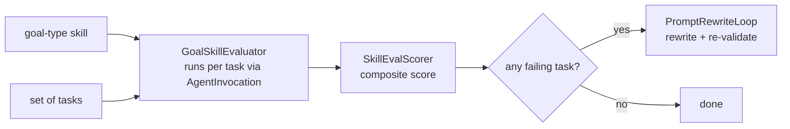

# POC 5 — Eval (scoring a goal-type skill)

Adapts Embabel's `embabel-agent-eval` (built for conversational agents) to a **goal-type, non-chat
skill**, so a generated skill can be scored and its prompt refined.

## What it proves

- **An LLM eval harness can score a goal-type skill (C6).** Via `AgentInvocation`, the eval produces
  a composite score for the skill over a set of tasks.
- **Eval scores are a stable, repeatable signal (docs/04 caveat #4).** The same skill + tasks run
  `BUILDER_EVAL_RUNS` times (default 5); the per-run composite scores' mean/range/stdev and a
  stable/noisy verdict are reported. For the explainer skill the range is 0 across runs — the
  non-LLM scoring is deterministic, so the score is only as noisy as the LLM's outputs, which for a
  well-behaved skill is none.
- A failing task yields a revised prompt, and the revised draft re-validates (the stretch goal that
  POC 9 turns into a full refinement loop).

## How it works



`GoalSkillEvaluator` runs the skill per task through `AgentInvocationSkillInvoker`; `SkillEvalScorer`
builds the composite score; `PromptRewriteLoop` rewrites a failing task's prompt and re-validates.
Reuses POC 1's `StepSpecAssembler`/`SkillPackTypeMapper` to deploy the target — hence this module
depends on `poc-1-no-code-runtime`.

## Run it

Endpoint-gated:

```bash
# Composite score + eval-score stability (default: 5 runs).
BUILDER_PACK_DIR="$PWD/skill-packs/explainer" \
    mvn -pl poc/poc-5-eval spring-boot:run

# Just the composite score, no stability measurement:
BUILDER_PACK_DIR="$PWD/skill-packs/explainer" BUILDER_EVAL_RUNS=1 \
    mvn -pl poc/poc-5-eval spring-boot:run
```

## Conclusion

Against the hypothesis (claim C6): **proven, and stable.** The LLM eval harness scores a goal-type
skill (composite **1.0** over the explainer's tasks), and the score is a repeatable signal: 5 runs
of the same skill + tasks gave per-run composites `[1.0 ×5]` — mean 1.0, range 0.0, stdev 0.0,
`STABLE` — because the non-LLM scoring is deterministic and the noise comes only from the LLM's
outputs, which for a well-behaved skill is none. What remains unmeasured is stability on a *weak*
skill, whose outputs vary more (its score would read as a distribution, not a point). The
failing-task → revised-prompt path is the stretch goal POC 9 turns into the full refinement loop.

See `docs/04-poc-run-results.md`.
