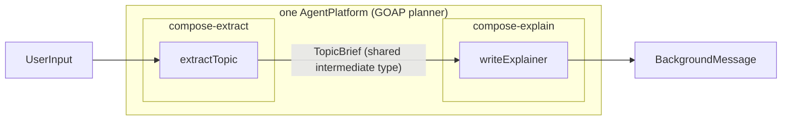

# POC 6 — Skill composition (skills as functions)

Two **independent** skill-packs, each with its own exported goal, are loaded into one platform; the
non-LLM GOAP planner chains an action from each pack through their shared intermediate type — no
orchestration code.

## What it proves

- **Skills compose (C8).** The planner chains `extractTopic` (from `compose-extract`) →
  `writeExplainer` (from `compose-explain`) through their shared `TopicBrief` type and returns the
  final goal's output. A skill pack is therefore a *composition primitive*, not just a leaf.

## How it works



`CompositionRunner` loads both packs' step specs into one `AgentPlatform` and runs a plan over the
final goal; GOAP resolves the chain by the shared intermediate type.

## Run it

Endpoint-gated:

```bash
BUILDER_PACK_DIRS="$PWD/skill-packs/compose-extract,$PWD/skill-packs/compose-explain" \
BUILDER_TARGET_GOAL=explainerDone BUILDER_INPUT="Explain how a coffee machine works" \
    mvn -pl poc/poc-6-skill-composition spring-boot:run
```

## Conclusion

Against the hypothesis (claim C8): **proven.** Two independent skill-packs load into one platform
and the non-LLM GOAP planner chains an action from each — `extractTopic` → `writeExplainer`
through the shared `TopicBrief` — with no orchestration code (live: goal achieved in ~14–22 s
across runs). A skill-pack is therefore a *composition primitive*, not just a leaf; POC 14's
Composer generalizes this to a type-checked canvas with composite export.

See `docs/04-poc-run-results.md`.
