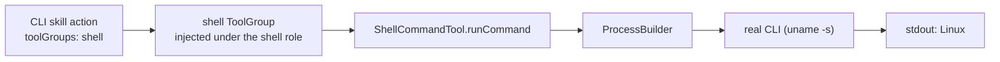

# POC 7 — Runtime adapter (CLI / script invocation)

A skill-pack action declares `toolGroups: [shell]`; the platform injects a self-published `shell`
tool group under that role so the skill runs a **real CLI** with no orchestration code — the
"normal agent harness" promise.

## What it proves

- **Skills invoke CLIs/scripts (C11).** The `shell-runner` skill's action called
  `runCommand({"command":"uname -s"})` and the goal returned the real output (`"stdout":"Linux"`).
  A skill is therefore not locked to LLM-only actions — it can drive the host.
- The tool group is auto-discovered by the platform's `RegistryToolGroupResolver`.

> Integration note: Embabel's `ToolGroupMetadata`/`getVersion()` are Kotlin-mangled and
> unimplementable from Java, so the group is registered via reflection on the mangled companion
> (`ShellToolGroupFactory`).

## How it works



`ShellCommandTool` exposes a `runCommand` tool (via `ProcessBuilder`); `ShellToolGroup` publishes it
as a `ToolGroup` bean under the `shell` role; `AdapterRunner` deploys the CLI skill with that tool
group in scope and runs the plan.

## Run it

Endpoint-gated:

```bash
BUILDER_PACK_DIR="$PWD/skill-packs/shell-runner" \
BUILDER_INPUT="Run the command: uname -s, and report the result" \
    mvn -pl poc/poc-7-runtime-adapter spring-boot:run
```

See `docs/04-poc-run-results.md`.
