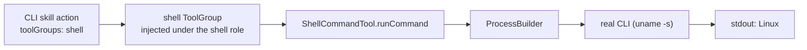

# POC 7 — Runtime adapter (CLI / script invocation)

A skill-pack action declares `toolGroups: [shell]`; the platform injects a self-published `shell`
tool group under that role so the skill runs a **real CLI** with no orchestration code — the
"normal agent harness" promise.

## What it proves

- **Skills invoke CLIs/scripts (C11).** The `shell-runner` skill's action called
  `runCommand({"command":"uname -s"})` and the goal returned the real output (`"stdout":"Linux"`).
  A skill is therefore not locked to LLM-only actions — it can drive the host.
- The tool group is auto-discovered by the platform's `RegistryToolGroupResolver`.

> Integration note: Embabel's `ToolGroupMetadata`/`getVersion()` are Kotlin-mangled and
> unimplementable from Java, so the group is registered via reflection on the mangled companion
> (`ShellToolGroupFactory`).

## How it works



`ShellCommandTool` exposes a `runCommand` tool (via `ProcessBuilder`); `ShellToolGroup` publishes it
as a `ToolGroup` bean under the `shell` role; `AdapterRunner` deploys the CLI skill with that tool
group in scope and runs the plan.

## Run it

Endpoint-gated:

```bash
BUILDER_PACK_DIR="$PWD/skill-packs/shell-runner" \
BUILDER_INPUT="Run the command: uname -s, and report the result" \
    mvn -pl poc/poc-7-runtime-adapter spring-boot:run
```

## Measured results (shared — runtime bridges, C11 / C16)

POCs 7, 13, and 16 prove the three runtime bridges doc 03 §2.3 names — the "normal agent
harness". This results section is **shared across their READMEs** (identical in each); the
consolidated read is in `docs/04-poc-run-results.md` §7.2.

| bridge | POC | live evidence | LLM calls in the plan |
| --- | --- | --- | --- |
| shell (local CLI) | POC 7 | `runCommand` → `{"stdout":"Linux"}`; goal achieved | 1 (action body) |
| MCP (remote tool) | POC 13 | `explainTopic` invoked over Streamable HTTP by a separate client | 1 (action body) |
| remote action (sidecar) | POC 16 | `remoteDigest` executed over HTTP to a separate process; plan in ~0.13 s | 0 |

All three: the same GOAP planner plans over, and executes, an action that runs outside the LLM —
in a local CLI, a remote MCP server, or a separate sidecar process.

## Conclusion

Against the hypothesis (claim C11, local-CLI half): **proven.** The `shell-runner` skill invoked a
real CLI through an injected `shell` tool group (`runCommand({"command":"uname -s"})` →
`"stdout":"Linux"`, goal achieved), so a skill is not locked to LLM-only actions — it can drive the
host. The tool group is auto-discovered by the platform's `RegistryToolGroupResolver`. The one
friction point: Embabel's `ToolGroupMetadata`/`getVersion()` are Kotlin-mangled, so the group is
registered via reflection on the mangled companion — integration friction a first-party
Java-friendly tool-group API would remove. See the shared results above for the other two bridges
(POC 13, POC 16).

See `docs/04-poc-run-results.md`.
