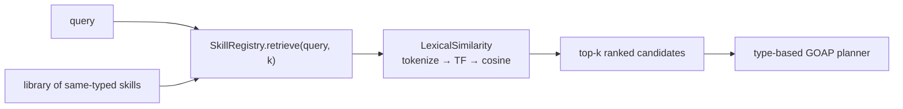

# POC 8 — Retrieval at scale (skill shadowing)

A `SkillRegistry` indexes a library of **same-typed** skill-packs; a lexical (TF-IDF/cosine)
pre-filter narrows candidates before the type-based GOAP planner runs. Fully offline and
deterministic — running a selected skill is covered by POC 1 / POC 7.

## What it proves

- **Skills are retrievable / disambiguable (C10, lexical, small scale).** With 14 skills all
  `UserInput → BackgroundMessage` (so type alone can't select), the lexical retriever hits
  **Precision@1 100%** and keeps the target top-1 as same-verb distractors are added.
- The **shadowing factor** — the number of type-compatible skills a query must be disambiguated
  against — is measured. The semantic 200+ skill scale is the remaining gap (POC 12).

## How it works



`SampleSkillLibrary` builds a same-typed library; `SkillRegistry` indexes it and `retrieve(query, k)`
ranks candidates by `LexicalSimilarity` (tokenize → TF → cosine); `RetrievalRunner` reports the
shadowing factor, precision@1, and the growth curve.

## Run it

Offline (no endpoint):

```bash
mvn -pl poc/poc-8-retrieval exec:java
```

See `docs/04-poc-run-results.md`.
