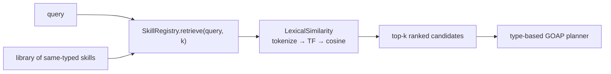

# POC 8 — Retrieval at scale (skill shadowing)

A `SkillRegistry` indexes a library of **same-typed** skill-packs; a lexical (TF-IDF/cosine)
pre-filter narrows candidates before the type-based GOAP planner runs. Fully offline and
deterministic — running a selected skill is covered by POC 1 / POC 7.

## What it proves

- **Skills are retrievable / disambiguable (C10, lexical, small scale).** With 14 skills all
  `UserInput → BackgroundMessage` (so type alone can't select), the lexical retriever hits
  **Precision@1 100%** and keeps the target top-1 as same-verb distractors are added.
- The **shadowing factor** — the number of type-compatible skills a query must be disambiguated
  against — is measured. The semantic 200+ skill scale is the remaining gap (POC 12).

## How it works



`SampleSkillLibrary` builds a same-typed library; `SkillRegistry` indexes it and `retrieve(query, k)`
ranks candidates by `LexicalSimilarity` (tokenize → TF → cosine); `RetrievalRunner` reports the
shadowing factor, precision@1, and the growth curve.

## Run it

Offline (no endpoint):

```bash
mvn -pl poc/poc-8-retrieval exec:java
```

## Measured results (shared — skill selection, C10)

POCs 8, 12, 17, 19, 20, and 23 test the same hypothesis — **skill selection at scale** (claim C10) —
on the same scenario, with different techniques. This results section is **shared across their
READMEs** (identical in each); the consolidated read is in `docs/04-poc-run-results.md` §7.1.

**Small scale (POC 8 — 14 same-typed skills, lexical):** Precision@1 **100%**; the target stays
top-1 as same-verb distractors are added (growth curve).

**Distinct scale (POC 12/20/23 — 191 same-typed skills, full-library P@1):**

| method | P@1 (191 distinct) |
| --- | --- |
| lexical (word TF) | 100% |
| dense (feature hash) | 100% |
| embedding (MiniLM, local ONNX) | 100% |
| embedding (nomic, remote) | 100% |

**Under shadowing (POC 12/20/23 — 281 skills incl. 90 same-topic near-duplicates, full-library P@1):**

| method | P@1 (281, shadowing) |
| --- | --- |
| lexical (word TF) | 17% |
| dense (feature hash) | 0% |
| embedding (MiniLM, local ONNX) | 33% |
| embedding (nomic, remote) | 17% |

**On the 6-target candidate sets (POC 17/19 — matching vs strict variants):**

| method | matching@1 | strict@1 |
| --- | --- | --- |
| lexical (word TF) | 17% | 33% |
| dense (feature hash) | 0% | 0% |
| transformer (GLiNER2) | 83% | **100%** |
| llm-id (Qwen3-0.6B) | 0% | 50% |
| llm-ood (Qwen3-0.6B) | 50% | 67% |

**Scaling dimension (POC 23 — remote nomic embedding, generated library to 1000 skills):**
Precision@1 holds at **100%** from 100 to 1000 same-typed skills; steady-state per-query retrieval
(cosine over cached vectors, no model call) grows linearly and stays sub-millisecond-to-~1.3 ms,
while the one-time embedding index (one embedding per skill) is paid once and amortised. A
per-candidate LLM/transformer selector would instead need *n* model calls per query.

| size | P@1 | per-query retrieval |
| --- | --- | --- |
| 100 | 100% | 0.48 ms |
| 200 | 100% | 0.41 ms |
| 400 | 100% | 0.54 ms |
| 800 | 100% | 1.04 ms |
| 1000 | 100% | 1.27 ms |

**Shared reading:** retrieval is clean while skills are distinct (100% at every scale, up to 1000
skills); near-duplicate shadowing collapses text-similarity (lexical 17%, dense 0%), and no
text-similarity index cures it. Methods that score by *meaning* — a zero-shot transformer (GLiNER2,
the best: strict 100%), a fine-tuned 0.6B LLM, and a real embedding index — beat text-similarity,
but the near-duplicates are near-identical in *meaning* too, so none fully cures the collapse on its
own (the remote nomic embedding ties lexical at 17% under shadowing — the specific embedding model
matters). And the scaling result is unambiguous: a remote `EmbeddingService` retrieves cleanly to
1000 skills with sub-millisecond-to-~1 ms per-query cost and **zero per-query model calls** — the
reason it is the selection mechanism of choice as the library outgrows per-candidate selectors. The
real fix for shadowing is library **curation** (dedup / lifecycle — POC 18, applied in the POC 15
retrieval pane).

## Conclusion

Against the hypothesis (claim C10, small scale): **proven.** With 14 skills all
`UserInput → BackgroundMessage` (so type alone can't select), the lexical retriever hits
**Precision@1 100%** and keeps the target top-1 as same-verb distractors are added — skills are
retrievable and disambiguable, and the shadowing factor is manageable at this scale. The
200+ skill scale and the shadowing failure it exposes are measured in POC 12 and answered by
POC 17 / POC 19 / POC 20 — see the shared results above.

See `docs/04-poc-run-results.md`.
