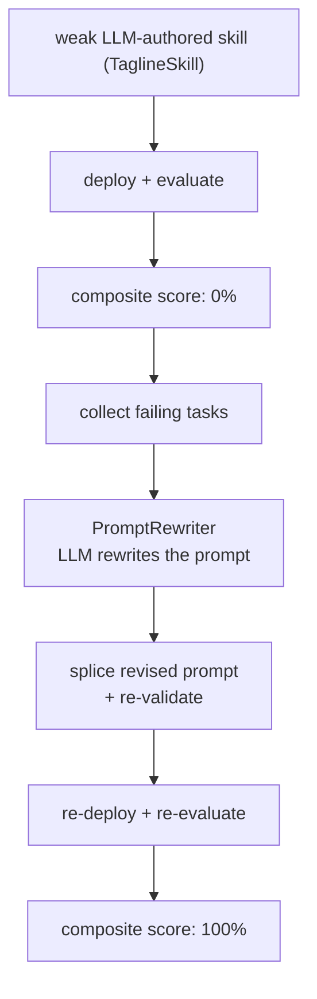

# POC 9 — LLM-authored quality + eval-guided refinement

The SkillAxe loop: evaluate a **weak LLM-authored skill**, rewrite its prompt from the failing eval
tasks, and re-evaluate — showing the loop actually improves the skill.

## What it proves

- **Eval-guided refinement repairs an LLM-authored skill (C9 fix).** A deliberately weak tagline
  skill (its prompt forbids the brand name) scores **0%** on two tasks; the LLM rewrite adds "the
  tagline must explicitly include the brand name"; it re-scores **100%**.
- The raw NL draft is still weak at the source (the confirmed caveat) — this POC demonstrates the
  *repair*, not a fix to the compiler.

## How it works



`RefinementRunner` deploys the original and revised skills as separate agents and scores each via
`runAgentFrom` (`RefinementScorer`); `PromptRewriter` splices the LLM's revised prompt into the named
step and re-validates. Scoring / re-validation is verifiable offline; the rewrite call is
endpoint-gated. The weak skill is `TaglineSkill`.

## Run it

Endpoint-gated:

```bash
mvn -pl poc/poc-9-quality-refinement spring-boot:run
```

## Conclusion

Against the hypothesis (claim C9 — "LLM-authored skills are good"): **negative at the source,
proven fix.** The raw NL draft is still weak (POC 2/3 measure it with the `DraftQuality`
classifier), but the eval-guided refinement loop repairs it end-to-end: a deliberately weak
tagline skill scores **0%** on two tasks, the LLM rewrite adds "the tagline must explicitly
include the brand name", and the re-score is **100%**. This is the SkillAxe loop (doc 03 §5)
working, and the same loop powers the POC 15 eval/refinement pane.

See `docs/04-poc-run-results.md`.
