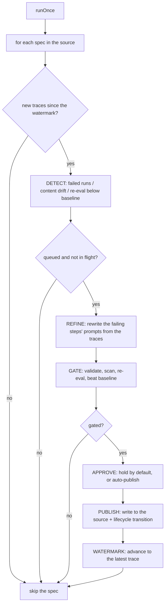

# embabel-smith-studio

The self-improving studio product: one Spring Boot web app that runs specs from a source,
builds new specs, and operates the trace-driven self-improvement loop — with a web UI where
each of those is a pane. It hosts the production cores from change 03 (runtime), change 04
(builder), and change 05 (self-improvement loop) behind a REST surface, and serves a Vue 3 +
Quasar SPA built from the same tree.

## Boot

Build the SPA into the app's `static/` directory, then run the app:

```
cd prod/embabel-smith-studio/frontend && npm install && npm run build
cd .. && mvn -pl prod/embabel-smith-studio spring-boot:run
```

The Vite build emits into `src/main/resources/static`, so the running app serves the UI at `/`
and the API under `/api`.

### Local port

The default port is `8080` (`SERVER_PORT`). If that port is held by another local service,
override it. The frontend dev server proxies `/api` to `http://localhost:18080`, so run the app
on `18080` for the `npm run dev` flow:

```
SERVER_PORT=18080 mvn -pl prod/embabel-smith-studio spring-boot:run
```

### Model endpoint (env-driven)

The model endpoint is fully environment-driven — nothing is hardcoded (same convention as the
runtime and builder). Three providers are supported and more than one can be live at once;
[Model providers and models](#model-providers-and-models) covers the variables, the
multi-provider setups, and how a model is chosen.

### Model-not-configured behavior

The app boots and the UI is reachable **without** a model endpoint configured. Model-backed
actions (Run, Build, Eval, and loop iterations that re-evaluate) return the structured
`MODEL_NOT_CONFIGURED` error rather than crashing; the model-backed panes render a dedicated
"model not configured" banner for it. Offline actions — listing sources and packs, the security
scan, the trust check, and reading traces — work regardless.

## Model providers and models

Three Embabel provider starters sit on the classpath — `embabel-agent-starter-openai`,
`embabel-agent-starter-openai-custom` and `embabel-agent-starter-anthropic`, declared by the
runtime and builder modules the studio depends on. The classpath is not the switch: **every
provider whose credentials resolve stays registered at the same time**, and the configuration
decides which of their models a run actually uses. A deployment can mix providers — Claude
through one client, GPT through another — with no code change and no restart.

### What each provider reads

| Provider | API key | Base URL | Models it registers |
|---|---|---|---|
| `openai` | `OPENAI_API_KEY` · `embabel.agent.platform.models.openai.api-key` | `OPENAI_BASE_URL` · `…openai.base-url` | Embabel's bundled OpenAI catalog |
| `anthropic` | `ANTHROPIC_API_KEY` · `embabel.agent.platform.models.anthropic.api-key` | `ANTHROPIC_BASE_URL` · `…anthropic.base-url` | Embabel's bundled Anthropic catalog |
| `openai-custom` | `OPENAI_CUSTOM_API_KEY` · `…openai.custom.api-key` | `OPENAI_CUSTOM_BASE_URL` · `…openai.custom.base-url` | exactly the names in `OPENAI_CUSTOM_MODELS` · `…openai.custom.models` |

The env var wins over the property when both are set, so a deployment normally needs no YAML at
all. Only `openai-custom` takes a model list; the other two register the catalog shipped in their
own jar. `embabel.agent.platform.models.options.http-headers` adds a header to every call, for
gateways that demand one.

### Which provider serves a model

Model lookup searches the flat list of registered model beans and uses the provider that
registered that name — there is no primary provider. So when two providers are configured,
`claude-opus-4-6` goes out over the Anthropic client and `gpt-6-astra` over the OpenAI one. The
base URL is per provider, and the two may be the same host: a Copilot-style gateway that speaks
both wire formats serves both families from one origin, and the model name alone picks the client.

A name that no registered provider knows fails the call with `NoSuitableModelException`, naming
what is available. There is no silent fallback to a default model.

### Setup: one gateway, both model families

```bash
export OPENAI_BASE_URL=https://api.githubcopilot.com
export OPENAI_API_KEY=<copilot-token>
export ANTHROPIC_BASE_URL=https://api.githubcopilot.com   # same origin, Anthropic wire format
export ANTHROPIC_API_KEY=<copilot-token>
export EMBABEL_MODELS_DEFAULT_LLM=claude-sonnet-4-5
unset OPENAI_CUSTOM_BASE_URL OPENAI_CUSTOM_API_KEY OPENAI_CUSTOM_MODELS
```

The gateway has to serve both formats — `/chat/completions` for the OpenAI client, `/v1/messages`
for the Anthropic one — and each model name must be one it accepts. Names the bundled catalogs
don't carry need the catalog override below.

### Setup: a local LLM

```bash
export OPENAI_CUSTOM_BASE_URL=http://localhost:11434/v1
export OPENAI_CUSTOM_API_KEY=local        # any non-blank value; the starter rejects a blank one
export OPENAI_CUSTOM_MODELS=qwen3:32b
export EMBABEL_MODELS_DEFAULT_LLM=qwen3:32b
```

`openai-custom` is the only provider in play: it registers exactly the models listed, and the
other two stay on the placeholder keys the app's own `application.yml` supplies — which is what
lets the app boot with nothing configured. See the gotchas for when "inert" stops holding.

### Choosing the model

Three levers, broadest first:

1. **The deployment default** — `EMBABEL_MODELS_DEFAULT_LLM`, or `embabel.models.default-llm`. It
   may name a model or a role.
2. **A role** — `embabel.models.llms.<role>: <model>`. Use the flat map in a multi-provider
   deployment: the nested `embabel.models.roles.<role>.<provider>` form is read for the
   deployment's own provider only, so it cannot pin one role to Claude and another to GPT. A role
   naming an unregistered model fails the boot rather than degrading quietly.
3. **A pane** — the **Model** select on each pane that launches a model: Run, Author, the Process
   workspace (one selector for generate, extract and simulate), Eval, and Auto-improve. Leaving it
   empty uses the deployment default, which the header chip and footer also show. Run and Simulate
   pin the choice as `llm.model` onto the *staged* copies of the pack's steps, so the pack on disk
   is never rewritten; the builder's own calls — Author, Generate, Extract, Eval, and the loop's
   refine and re-eval — pin it onto that one call's `LlmOptions`.

Model names are the catalogs' `model_id`s — `gpt-6-astra`, `gpt-5.6-luna`, `claude-opus-4-6`,
`claude-sonnet-4-5` — not the YAML bean names (`gpt6astra`, `claude_opus_46`).

### Models outside the bundled catalogs

To use a name the OpenAI or Anthropic catalog doesn't carry, replace that catalog: copy
`models/openai-models.yml` (or `models/anthropic-models.yml`) out of its autoconfigure jar into
`src/main/resources/models/` and edit it. The loader takes the first classpath match, so the
application's copy wins **wholesale** — it replaces the jar's list rather than extending it. Keep
`model_id` to what the gateway accepts: it is both the lookup key and the value sent on the wire.

This also trims the picker. With a catalog provider configured, the Model select offers every LLM
in that catalog, including ones the gateway has no route for — those fail when called.

### Checking what is live

- `GET /api/status` — whether the studio's gate is satisfied, the default model it resolved, and
  the exact missing-variables message when it isn't.
- `GET /api/models` — the names the panes offer and the default offered with them.

The gate resolves **one** provider: the first of `openai-custom`, `openai`, `anthropic` that shows
any sign of being configured, and for the two catalog providers it also requires
`EMBABEL_MODELS_DEFAULT_LLM`. It decides only whether model-backed actions may run — it does not
restrict which provider serves a model chosen in a pane.

### Gotchas

- **A leftover `OPENAI_CUSTOM_*` variable wins the gate**, and then `/api/models` offers only
  `OPENAI_CUSTOM_MODELS` — hiding the gateway's other models. Unset them for a gateway deployment.
- **Unset, don't empty.** An empty `OPENAI_API_KEY` passes that provider's null check and reaches
  the SDK as an empty key; an empty `OPENAI_BASE_URL` reaches it as an empty host. Only
  `openai-custom` treats blank as missing.
- **Ambient keys enable providers.** An `OPENAI_API_KEY` or `ANTHROPIC_API_KEY` left over from
  other work registers that provider as well, so its models appear in the picker — and cost money
  when selected — even in a run meant to stay local.
- **No endpoint still boots.** `application.yml` gives all three providers an inert placeholder
  key, which is what satisfies the starters' key checks at construction time; the gate then answers
  `MODEL_NOT_CONFIGURED` for model-backed actions while the offline panes keep working.
- **With no improve source the loop reads the checkout, and publishes nothing into it.** Unset, the
  loop's source is the builder's own packs under `prod/embabel-smith-builder/src/main/resources/specs` —
  the source tree, never `target/classes`, because a build recopies that and would silently revert
  a candidate. Reading it needs no decision; naming a destination does, so an approved candidate
  still refuses to publish until `smith.studio.improve-source` is set, and the studio never publishes
  into the working checkout — the one write that source-tree surface can see is the `lifecycle.yml`
  sidecar the loop stamps into a pack directory when it detects a regression, which the publish
  refusal does not gate but which a clean checkout never gets, because the absent sidecar's baseline
  is 0.0, the comparison against it is strict, and no `lifecycle.yml` ships anywhere under `prod/`. Run
  from a checkout: an installed binary has no source tree to point
  at, and the boot says so rather than handing the loop the built copy.

## Configuration

| Property | Env | Default | Purpose |
|---|---|---|---|
| `smith.studio.sources` | `SMITH_STUDIO_SOURCES` | — | Comma-separated source URIs the UI offers (`folder:<path>` or `git:<url>[@ref]`). |
| `smith.studio.improve-source` | `SMITH_STUDIO_IMPROVE_SOURCE` | first of `sources`, else the builder's pack sources | The source the loop watches and refines. |
| `smith.studio.trace-dir` | `SMITH_STUDIO_TRACE_DIR` | `~/.smith/traces` | Trace store dir; the store file is `<dir>/runs.jsonl`. |
| `smith.studio.source-cache-dir` | `SMITH_STUDIO_SOURCE_CACHE_DIR` | `~/.smith/spec-sources` | Git source cache root. |
| `smith.studio.loop.interval` | `SMITH_STUDIO_LOOP_INTERVAL` | `60000` | Interval between scheduled iterations (ms); the schedule is **off by default**. |
| `smith.studio.loop.auto-publish` | `SMITH_STUDIO_LOOP_AUTO_PUBLISH` | `false` | Auto-publish gated candidates instead of holding them. |

## Panes

| Pane | Backed by | Notes |
|---|---|---|
| Run | change-03 runtime | Pick a source + goal, submit an input, see the goal output. |
| Build | change-04 builder | Describe a spec and publish it to a source. |
| Eval | change-04 builder | Score a spec over its tasks and refine the prompt from failures. |
| Lifecycle | builder sidecars | Each pack's lifecycle state, baseline, and content-hash drift. |
| Security | install-time scanner | Static scan of a pack; offline. |
| Trust | trust-tier policy | Check a spec's tool groups against a trust tier; offline. |
| Traces | change-03 trace store | A spec's recent runs, most recent first, with per-step drill-down. |
| Auto-improve | change-05 loop | Loop control, pending candidates with evidence, approve/reject, auto-publish. |
| Storage | storage context | Point the studio at its Postgres database and pick the trace backend; save validates and rebinds live. |
| Compose / Retrieve / Scale / Remote | — | POC-only panes, kept for reference and disabled in the product. |

## REST surface

| Endpoint | Purpose |
|---|---|
| `POST /api/run` | Run a goal (source, goal, input, planner, trust tier, model). |
| `GET /api/status` | Endpoint readiness: configured flag, resolved default model, config error. |
| `GET /api/models` | The models the panes offer, and the default offered with them. |
| `POST /api/build` | Build a pack (description, output source). |
| `POST /api/eval` | Score + refine a spec over its tasks. |
| `GET /api/sources` | List the configured sources. |
| `GET /api/packs?source=` | List a source's packs with lifecycle state + drift. |
| `GET /api/traces?spec=&limit=` | A spec's trace window, most recent first. |
| `POST /api/security` | Static scan of a pack. |
| `POST /api/trust` | Trust-tier check for a pack. |
| `GET /api/improve/candidates` | Pending loop candidates with evidence. |
| `POST /api/improve/candidates/{id}/approve` | Approve + publish a candidate. |
| `POST /api/improve/candidates/{id}/reject` | Reject a candidate. |
| `POST /api/loop/trigger` | Run one on-demand iteration. |
| `POST /api/loop/start` · `stop` | Start / stop the interval schedule. |
| `GET /api/loop/status` | Loop schedule + auto-publish state. |
| `GET` · `PUT` `/api/loop/auto-publish` | Read / set auto-publish. |
| `GET` · `PUT` `/api/storage-settings` | Read / set the database endpoint + trace backend (PUT validates the connection and rebinds live). |
| `GET /api/store/packs` · `GET /api/store/packs/{name}` | List saved packs / load one by name. |
| `POST /api/store/packs` | Save a pack to the database. |
| `GET /api/store/packs/{name}/download` | A saved pack as a zip. |
| `POST /api/store/packs/import` | Import an agent-spec directory from a filesystem path into the database. |
| `GET /api/store/discoveries` | The recorded discovery history. |

The request/response DTOs mirror the TypeScript types in `frontend/src/api/types.ts`;
`vue-tsc --noEmit` catches a field rename on either side.

## Durable storage (Postgres)

Saved packs, the discovery history, and run traces live in a Postgres database the user points at
from the **Storage** pane. The app **boots and stays usable with no database** — the datasource and
JPA auto-configurations are excluded, and storage is bound **programmatically and hot-swapped** on
rebind (nothing JPA-related is a Spring bean, so a rebind never orphans live beans). When unbound,
listing endpoints return empty and writes report "storage not configured".

- **Dev database:** `docker compose up -d` (in this directory) starts a `postgres:16` at
  `jdbc:postgresql://localhost:5432/smith_studio` (user/password `smith`/`smith`, db `smith_studio`,
  named volume `studio-pgdata`). Point the Storage pane at it.
- **Settings** persist as `~/.smith/studio/storage.json` (mode 0600) — they cannot live in the
  database they configure.
- **Trace backends** are pluggable and switchable at runtime: `jsonl` (default, the change-03 file
  store), `postgres-same` (the packs' database), or `postgres-separate` (an independent database).

## Operating the loop

The interval schedule is **off by default**: on a fresh start no iterations run until the user
starts the schedule (Auto-improve pane) or triggers one on demand.

- **Trigger** — one iteration now; the pane reports which specs were detected, refined, gated,
  and published or queued.
- **Start / Stop** — run iterations at the configured interval until stopped.
- **Auto-publish** — when on, gated candidates are published immediately; when off (default)
  they are held in the queue for approval. The loop is always built in hold mode; the toggle is
  applied at the loop-service layer so it takes effect live.
- **Approve / Reject** — approve publishes a held candidate and transitions its lifecycle;
  reject discards it.

## The self-improvement loop

The loop watches the runtime's traces (change 03) and, for each spec in the source, detects
that it is failing or drifting, refines it (change 04's builder core), gates the candidate, and
publishes the approved one back to the source with a lifecycle transition. One pass is
`ImprovementLoop.runOnce()`.

The loop logic is plain Java — no web, no scheduling required to test it. Model calls (refine,
re-eval) are endpoint-gated.

### Flow



Per spec:

1. **Detect** — the rolling window of the most recent traces (default 200) is checked for
   failed runs (minus trust-tier blocks, which are a policy outcome, not a spec defect),
   content drift (the pack's content hash differs from the sidecar's recorded hash), and a
   live re-eval below the baseline (regression, only spent for `active`/`degraded` specs).
2. **Refine** — the prompts of the failing steps are rewritten using the failure traces as
   evidence (input, output excerpt, failure reason); steps without failure evidence are
   left unchanged.
3. **Gate** — the candidate must clear every gate (below).
4. **Approve** — the gated candidate is held in the `ApprovalQueue` (default) or auto-published.
5. **Publish** — the candidate is written to the source and the lifecycle transitions.
6. **Watermark** — the last processed trace is recorded, so a re-run over unchanged traces
   publishes nothing.

### Gate order (cheap first)

A candidate must clear every gate before it may be published, run cheap-first so a broken or
unsafe candidate never spends eval budget:

1. **D5 validation** — structural validation of the candidate (free, deterministic).
2. **Security scan** — the static scanner; a critical finding blocks (free, deterministic).
3. **Re-eval** — the candidate is deployed and run against the eval tasks (costs model calls).
4. **Baseline comparison** — the pass-rate must be *strictly* greater than the pack's baseline.

A rejection names the stage and records the reasons (and, when reached, the score and scan).

### Lifecycle

The sidecar's state moves as the spec improves and regresses (POC 18, carried into the
product):

```
incubating --first proven improvement--> active --regression--> degraded --sustained regression--> retired
                                              ^                                |
                                              +--- new gated candidate published +
```

- `incubating → active` on a first proven improvement (a gated candidate is published).
- `active → degraded` when a live re-eval scores below the baseline.
- `degraded → retired` when the next re-eval fails again.
- `degraded → active` when a new gated candidate is published (recovery).

The state is advisory — the runtime enforces trust tiers, not lifecycle state.

### Approval semantics

The default is **hold**: a gated candidate is queued in the `ApprovalQueue`, not published.
Approving a candidate publishes it and transitions the lifecycle; rejecting discards it. An
`autoPublish` mode publishes gated candidates immediately, leaving the queue empty.

### v1 limitations

- **In-memory queue** — the `ApprovalQueue` and the per-spec watermarks live in memory; a
  restart loses pending candidates and reprocesses the window from the start.
- **Advisory lifecycle** — the sidecar state is recorded but not enforced; only the runtime's
  trust tiers are binding.
- **No per-spec error isolation** — a failure while refining, gating, or publishing one spec
  aborts the pass; that spec's watermark is not advanced, so it is retried on the next run, but
  the specs later in the pass wait for the next interval.

## Frontend

The SPA lives in `frontend/` (Vue 3 + Quasar + Vite + TypeScript) and keeps the POC 22
architecture: pure logic (the `traces/model.ts` and `improve/model.ts` modules, the
`useSourceSpec` composable) separated from the views, a single `fetch` site in
`frontend/src/api/client.ts`, and a TypeScript type contract (`frontend/src/api/types.ts`)
mirroring the REST DTOs.

```
cd prod/embabel-smith-studio/frontend
npm install
npm run typecheck   # vue-tsc --noEmit
npm test            # vitest
npm run build       # emit into src/main/resources/static
```
