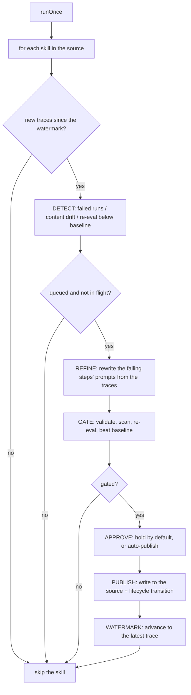

# embabel-smith-studio

The self-improving studio product: hosts the runtime and builder, and runs the
self-improvement loop over the skill source. This module currently holds the loop and its
tests; the REST surface and web UI are change 06 (`06-smith-studio-product`).

## The self-improvement loop

The loop watches the runtime's traces (change 03) and, for each skill in the source, detects
that it is failing or drifting, refines it (change 04's builder core), gates the candidate,
and publishes the approved one back to the source with a lifecycle transition. One pass is
`ImprovementLoop.runOnce()`; change 06 schedules it and exposes it over REST.

The loop logic is plain Java — no web, no scheduling required to test it. Model calls
(refine, re-eval) are endpoint-gated.

### Flow



Per skill:

1. **Detect** — the rolling window of the most recent traces (default 200) is checked for
   failed runs (minus trust-tier blocks, which are a policy outcome, not a skill defect),
   content drift (the pack's content hash differs from the sidecar's recorded hash), and a
   live re-eval below the baseline (regression, only spent for `active`/`degraded` skills).
2. **Refine** — the prompts of the failing steps are rewritten using the failure traces as
   evidence (input, output excerpt, failure reason); steps without failure evidence are
   left unchanged.
3. **Gate** — the candidate must clear every gate (below).
4. **Approve** — the gated candidate is held in the `ApprovalQueue` (default) or auto-published.
5. **Publish** — the candidate is written to the source and the lifecycle transitions.
6. **Watermark** — the last processed trace is recorded, so a re-run over unchanged traces
   publishes nothing.

### Gate order (cheap first)

A candidate must clear every gate before it may be published, run cheap-first so a broken or
unsafe candidate never spends eval budget:

1. **D5 validation** — structural validation of the candidate (free, deterministic).
2. **Security scan** — the static scanner; a critical finding blocks (free, deterministic).
3. **Re-eval** — the candidate is deployed and run against the eval tasks (costs model calls).
4. **Baseline comparison** — the pass-rate must be *strictly* greater than the pack's baseline.

A rejection names the stage and records the reasons (and, when reached, the score and scan).

### Lifecycle

The sidecar's state moves as the skill improves and regresses (POC 18, carried into the
product):

```
incubating --first proven improvement--> active --regression--> degraded --sustained regression--> retired
                                              ^                                |
                                              +--- new gated candidate published +
```

- `incubating → active` on a first proven improvement (a gated candidate is published).
- `active → degraded` when a live re-eval scores below the baseline.
- `degraded → retired` when the next re-eval fails again.
- `degraded → active` when a new gated candidate is published (recovery).

The state is advisory — the runtime enforces trust tiers, not lifecycle state.

### Approval semantics

The default is **hold**: a gated candidate is queued in the `ApprovalQueue`, not published.
Approving a candidate publishes it and transitions the lifecycle; rejecting discards it. An
`autoPublish` mode publishes gated candidates immediately, leaving the queue empty. Change 06
exposes the queue over REST for the web UI.

### v1 limitations

- **In-memory queue** — the `ApprovalQueue` and the per-skill watermarks live in memory; a
  restart loses pending candidates and reprocesses the window from the start.
- **Advisory lifecycle** — the sidecar state is recorded but not enforced; only the runtime's
  trust tiers are binding.
- **No scheduling** — `runOnce()` is invoked by a caller; change 06 wires it to a scheduler.
- **No per-skill error isolation** — a failure while refining, gating, or publishing one skill
  aborts the pass; that skill's watermark is not advanced, so it is retried on the next run, but
  the skills later in the pass wait for the next interval.
